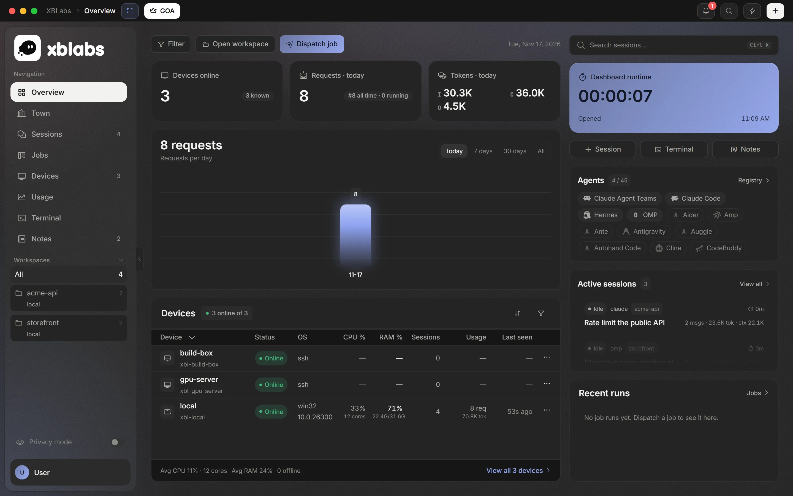
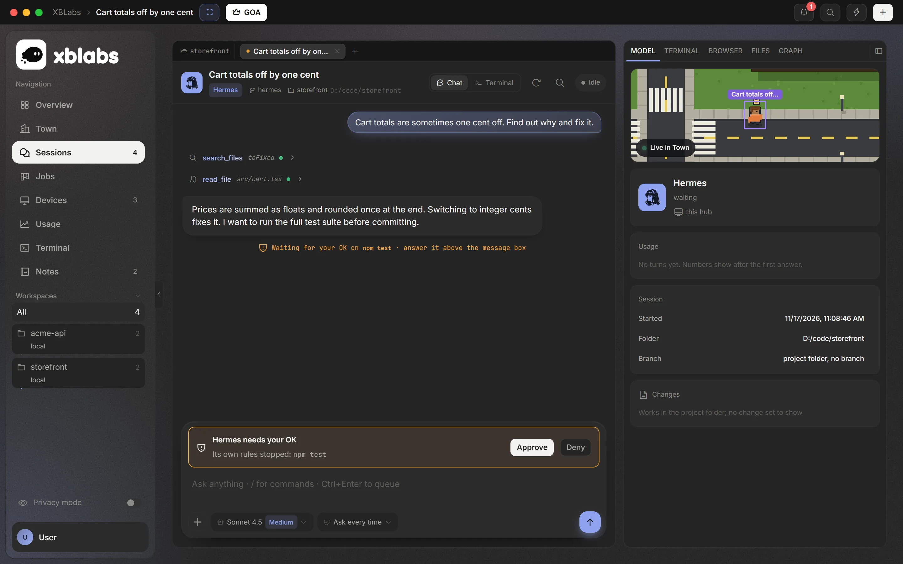
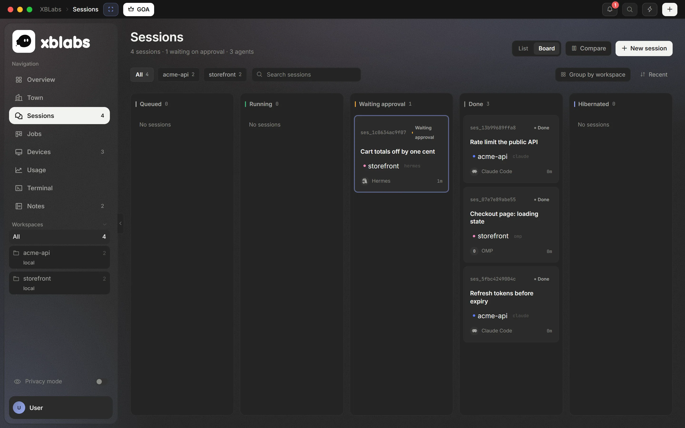

# XBLabs

A workspace for AI coding agents on your own machines. Run Claude Code, Hermes, OMP or any
OpenAI-compatible CLI on this computer or on others in your tailnet. You can follow each run as
a chat or in a real terminal, answer its approvals from one place, and review what changed.

One Node hub serves a web UI with no build step. A Tauri shell packages the hub and the UI as a
desktop app.



| Agent session | Sessions board |
| --- | --- |
|  |  |

## What it does

- **Sessions.** Each agent run is a session in a project folder or its own git worktree. You can
  view it as a chat (answers, thinking, tool calls, subagents) or as the agent's own terminal,
  with a side panel for the model, terminal, browser, files and graph.
- **Approvals in one place.** A command an agent wants to run shows up as a card above the message
  box and in notifications. You can set each session to ask every time, auto-approve, or allow
  reads only.
- **Many agents at once.**
  - **Compare** sends one prompt to several agents, each on its own branch.
  - **Pipeline** chains stages (plan → build → review) on one branch.
  - **Team** has a lead agent split a goal into tasks. Teammates work on the tasks in the
    background and report back to the lead.
- **Graph.** A tree you can pan and zoom, showing a session, its subagents, teammates or
  pipeline stages, plus the background processes it started (you can stop them).
- **Devices.** The fleet is your tailnet. A host with sshd opens a shell over Tailscale, and a
  host running the XBLabs agent also runs sessions remotely.
- **Usage.** Tokens and requests per session and per day. If your endpoint runs 9router, the
  Usage page also shows its own dashboard.
- **Also included:** Notes (plain `.txt` files), Town (a live pixel view of running agents),
  Focus mode, Privacy mode, a command palette, and themes.

## Run it

Requires Node.js 22.13 or later (the hub uses the built-in `node:sqlite`).

```bash
npm install
npm run dev          # http://127.0.0.1:5200
```

The hub serves `app/` and owns all state:

- `data/xblabs.db` holds sessions, jobs and settings.
- `data/Notes/*.txt` holds notes.
- Each run is a process the hub starts: `node-pty` for terminals, or the agent's JSON stream for
  chats.

Install the agent CLIs you want to use (`claude`, `hermes`, `omp`, …). The hub detects them on
`PATH`, and you can turn them on or off in Settings → Agents.

### One LLM endpoint for every run

Settings → **Models & keys** stores a base URL, an API key and a default model. Every run,
whether a local terminal or a remote agent, starts with these already in its environment:

```
LLM_BASE_URL        OPENAI_BASE_URL        ANTHROPIC_BASE_URL
LLM_API_KEY         OPENAI_API_KEY         ANTHROPIC_AUTH_TOKEN
LLM_MODEL           OPENAI_MODEL           ANTHROPIC_MODEL
```

The API only ever returns a masked hint of the key.

## Other machines

The hub reads the device list from Tailscale: the local `tailscale` client, or a `tskey-api-…`
key when the hub runs elsewhere. A tailnet host with only sshd still opens a shell over the
tailnet. To run sessions on a device, attach the agent there with one line:

```bash
curl -fsSL http://<hub-host>:5200/install.sh | sh          # Linux / macOS
```

```powershell
irm http://<hub-host>:5200/install.ps1 | iex                # Windows
```

The agent connects out to the hub, so the remote machine needs no open inbound port. On the
tailnet no token is needed, because Tailscale already authenticates the connection. On any other
network, start the hub with `XBLABS_HOST=0.0.0.0` and give both sides the same `XBLABS_TOKEN`.

## Desktop app (Tauri 2)

The shell in `src-tauri/` starts the bundled hub, waits for it, then opens a frameless window on
it.

- The packaged hub keeps its database in the app's data folder.
- If a hub is already listening on port 5200, the app uses that one instead.
- Closing the app stops the hub it started.

```bash
winget install Rustlang.Rustup
winget install Microsoft.VisualStudio.2022.BuildTools   # MSVC C++ build tools + Windows SDK
npm install
npm run tauri:build      # src-tauri/prep.mjs gathers node + server + app, then builds the NSIS installer
```

## Configuration

| Variable | Default | What it does |
| --- | --- | --- |
| `PORT` | `5200` | Hub port |
| `XBLABS_DB` | `./data/xblabs.db` | SQLite database; notes go in a `Notes/` folder next to it |
| `XBLABS_NOTES` | next to the db | Notes folder |
| `XBLABS_HOST` | loopback + Tailscale IP | Bind address, e.g. `0.0.0.0` for a LAN |
| `XBLABS_TOKEN` | none | Shared secret agents must present when not on the tailnet |
| `XBLABS_TAILSCALE` | on | `off` turns off the tailnet (demo hubs, CI) |
| `XBLABS_HOSTNAME` | OS hostname | The name shown for this host |

## Layout

| Path | What it is |
| --- | --- |
| `server/index.mjs` | HTTP + WebSocket hub: API, static files, scheduler |
| `server/chat.mjs`, `agents.mjs` | Chat sessions: one turn per agent run, parsed into events |
| `server/pty.mjs` | Terminal sessions (`node-pty`) |
| `server/team.mjs`, `pipeline.mjs` | Team and pipeline orchestration |
| `server/agent.mjs` | Remote device agent |
| `server/*.check.mjs` | Self-checks: `node server/<name>.check.mjs` |
| `app/` | The UI: plain HTML, CSS and JS, no framework, nothing to build |
| `src-tauri/` | Desktop shell |

## Shortcuts

`Ctrl K` search · `Ctrl J` quick commands · `Ctrl F` focus mode · `Ctrl ,` settings ·
`Ctrl B` sidebar · `Esc` close
